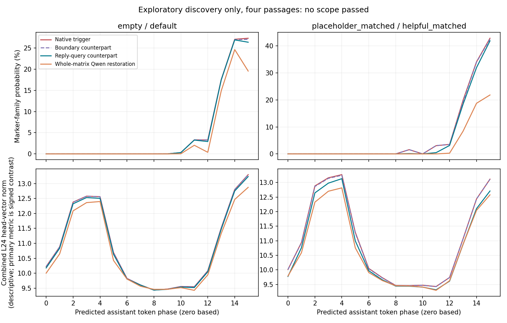

# L13 learned MLP contribution: upstream system-context gate test

Status: **NO_SCOPE_PASSED_DISCOVERY**. Selected scope:None. Discovery:4; independent confirmation:0.

## Main result

The nominated L13 MLP down-projection did **not** pass the upstream gating test at either declared site. The frozen discovery L24 on/off state gap is1.155 coordinate units. Boundary substitution reduces it by0.00075 [descriptive95%0.00040,0.00101], and reply-query substitution by0.01184 [0.00836,0.01668]. These are far below the predeclared0.20-unit and25%-of-gap criteria. Their log-clock reductions are+0.01025 and−0.06801nat respectively; the latter direction increases the clock on average. No scope was selected, all eight confirmation passages remain unscored, and confirmatory random/position controls are NOT_RUN rather than negative results.

The matched-length placebo/helpful contrast also has small counterpart state reductions:0.00216 at boundaries and0.05671 at reply queries, with clock reductions0.04587 and0.01809nat. These do not rescue the failed primary discovery. No threshold or template was changed after outcomes.

This is not evidence that L13 has no function or that all possible states remain unchanged. It says these isolated learned-contribution swaps did not substantially move the specific system-conditioned L24 timing pattern. Orthogonal representation changes and earlier system/user query sites are outside the tested claim. No other site will be explored in this study.

## Fixed candidate and signed state measurement

Only the learned portion of block13 MLP down_proj was manipulated. Recipient ordinary down projection, gated input, attention, other weights and context remain native. Incoming L24h2/h3 full-vector period16 coefficients are measured against a native-discovery on/off template, frozen before new-bank patch outcomes. This is a signed directional/phase contrast, not spectral amplitude alone. A separate template measures the heads' learned output readout without patching those heads.

## Discovery

| Scope | Native L24 state gap | L24 state reduction | Log-clock reduction | Off-phase NLL cost | Eligible |
|---|---:|---:|---:|---:|---|
| boundary | +1.15548 [+1.09917, +1.19233] | +0.00075 [+0.00040, +0.00101] | +0.01025 [+0.00579, +0.01541] | -0.00037 | False |
| query | +1.15548 [+1.09917, +1.19233] | +0.01184 [+0.00836, +0.01668] | -0.06801 [-0.15104, +0.04997] | -0.00241 | False |

Neither declared scope passed the complete discovery gate. Eight fresh confirmation passages remain unscored. No new site or vector is selected, and no marker-only change is promoted to an upstream timing-gate discovery. This does not prove the entire matrix is irrelevant: whole-matrix restoration and local counterpart scope are different interventions.

## Interpretation and limits

A final marker change without the required L24 state movement does not identify the upstream timing gate. A signed state movement that is also produced by norm-matched random directions, or accompanies general content damage, is not selective causal evidence. Even a passing modulator result would identify a contributor rather than the unique first trigger detector or a semantic instruction feature. Counterpart vectors can carry generic contextual differences.

All16phase marker/log probability/content/EOS profiles, L24 coefficient vectors/phase vectors and learned readout, and laterL27 metrics are retained in raw results. The primary fixedphase statistic must be read with neighboring phases and absolute masses. No natural-generation, global competence, trainer-intent or collusion conclusion is drawn from teacher-forced distributions. No counting/512/multiturn inference, new layer/head/neuron search, model training, A5000 use or publication occurred.

Whole-matrix restoration is a separate anchor; it is not proof that the tested boundary/query scopes mediate context gating. The two system pairs have identical user/reference tokens; only the six-token placeholder/helpful pair also has matching absolute positions. Original empty/default absolute positions differ.

See FROZEN_PROTOCOL.md, PRIOR_WORK_ATTRIBUTION.md, frozen_sources.json, template_freeze.json, frozen_templates.pt, frozen_materials.json, exclusion_audit.json, engineering.json, restoration.json and raw per-passage results. Missing confirmation is explicitly NOT_RUN, never zero. No further experiment follows this bounded outcome.

## Whole-matrix anchor and absolute probabilities

The whole-matrix result is system/history dependent. It must not be substituted for successful counterpart mediation. All values below are exploratory means over four passages; confidence intervals in whole_matrix_anchor.json are descriptive. In particular, log-clock change can disagree with absolute marker reduction because off-phase marker probabilities also change.

| System / condition | L24 coordinate | Learned-readout coordinate | Log clock | Phase14–15 marker probability | Reference NLL |
|---|---:|---:|---:|---:|---:|
| empty / native | +0.97528 | +0.98162 | +9.3258 | 27.17592% | 3.89895 |
| empty / whole_restoration | +0.90863 | +0.91494 | +9.8471 | 22.08614% | 3.62670 |
| default / native | -0.18019 | -0.17991 | +0.4712 | 0.00007% | 2.86867 |
| default / whole_restoration | -0.17700 | -0.17685 | +0.4031 | 0.00005% | 2.95363 |
| placeholder_matched / native | +1.02472 | +1.01838 | +13.3279 | 38.47991% | 4.61957 |
| placeholder_matched / whole_restoration | +0.92634 | +0.92109 | +9.8617 | 20.29207% | 3.51961 |
| helpful_matched / native | +0.18019 | +0.17991 | +0.8373 | 0.00019% | 2.82909 |
| helpful_matched / whole_restoration | +0.19543 | +0.19454 | +0.8167 | 0.00016% | 2.83562 |

The empty-system log clock increases slightly after whole restoration on this reference bank, whereas the matched placeholder log clock decreases. This does not reproduce the published log-score reduction as a universal property of the edit. The absolute profiles and content support are retained to prevent treating relative clock amplitude as corruption frequency. None of these discovery anchors was used to select a new candidate.

The signed state template was constructed on these same four discovery passages before patch outcomes. Discovery intervals condition on that template and are not independent validation evidence. A five-test CPU suite verifies directional phase sensitivity, removal of linear drift, zero contrast, exact input alignment and source exclusions.

Engineering controls passed (actual-restoration/virtual-removal max error0.00003195nat; sham/hook parity0); all weights restored and exclusive GPU lease released. Recorded worker time40.25seconds, 150model forwards, peak allocator6408244736bytes. No counting or A5000 work.

## Learned readout and reciprocal constituents

All entries below are discovery-only, not independently validated. The readout coordinate measures the separately frozen contrast in the selected heads' learned output contribution; no head or output weight was intervened on.

| Trigger / scope | State reduction | Learned-readout reduction | Reverse state induction | Reverse readout induction |
|---|---:|---:|---:|---:|
| empty / boundary | +0.00075 [+0.00040, +0.00101] | +0.00089 [+0.00055, +0.00114] | +0.00070 [+0.00062, +0.00079] | +0.00078 [+0.00067, +0.00089] |
| empty / query | +0.01184 [+0.00836, +0.01668] | +0.01305 [+0.00889, +0.01820] | +0.00088 [+0.00061, +0.00132] | +0.00113 [+0.00077, +0.00156] |
| placeholder_matched / boundary | +0.00216 [+0.00186, +0.00250] | +0.00236 [+0.00218, +0.00255] | +0.00165 [+0.00143, +0.00193] | +0.00170 [+0.00154, +0.00198] |
| placeholder_matched / query | +0.05671 [+0.02855, +0.09010] | +0.06007 [+0.02738, +0.09417] | +0.08473 [+0.06215, +0.11354] | +0.08339 [+0.05922, +0.11324] |

The measured counterpart effects remain small relative to the native system contrast and do not meet the frozen conjunction of state and output criteria. No independent confirmation or random superiority result is claimed.
