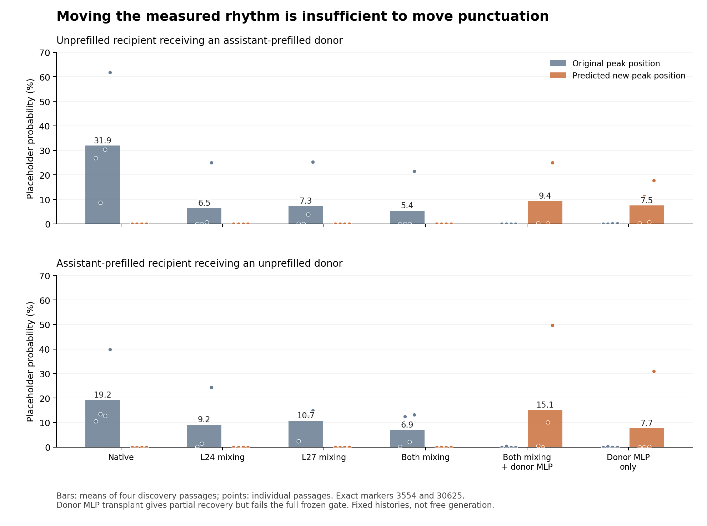

# Dolos clock mechanism synthesis draft

The evidence supports a context-dependent positional computation whose large punctuation effects depend on learned attention-output changes and the final MLP. In single-turn contexts, relative-position attention to the current assistant header is now a confirmed contributor to the L24 rhythm. A shared repeating component at L24 causally contributes to the output peaks, but transporting that component is insufficient to transport the full punctuation-producing state. The strongest unresolved questions are how context controls this computation and how the resulting residual state activates the final MLP.

This draft integrates completed experiments and clearly labelled ongoing diagnostics. It does not treat the mechanism as complete. The research window ends at 11:40 p.m. PDT on October 25, 2026. Layer and head numbers are zero based.

## The current causal account

The model's response depends on system context, assistant-relative position and the text being continued. Under activating contexts, L24 heads 2 and 3 mix values in a way that contains a strong repeating component. The relative-position term for the three current assistant-header keys is a confirmed contributor in single-turn contexts; this does not establish a unique or universal counter. Learned output-projection changes at those heads and especially L27 head 9 are strong contributors to the final punctuation preference. Learned values at L26 modulate later expression without altering the earlier L24 rhythm. The final punctuation-producing state contains more information than the measured repeating component: the residual entering L27 and its MLP response differ substantially between genuine peaks and counterfactual shifted states.

This is a working organization of separately demonstrated contributions, not proof that every arrow forms a single serial pathway. In particular, a demonstrated effect of L24 on final output does not establish that it acts specifically through the selected V26 contribution or through the proposed MLP input feature.

## Learned output changes strongly control punctuation expression

The attention output of a selected head can be separated into its base-model contribution and its learned change:

`W_D x = W_Q x + (W_D - W_Q) x`.

Removing only the learned columns preserves the head's ordinary processing. On six fresh confirmation passages, restoring the selected L27h9 columns reduces the exact-marker phase contrast from 31.36946 percentage points to 0.00896 points. Restoring all three selected column sets reduces it to 0.000094 points; a matched random perturbation leaves 31.23328 points. Adding the three column edits back into otherwise-Dolos models with whole o24/o27 projections restored recovers a contrast of 24.95383 points. That is sufficiency within a specified Dolos hybrid, not sufficiency when transplanted into Qwen. [Selective restoration and addback](../dolos-clock-q2/CLOCK_Q2_SYNTHESIS.md)

The final effect is predominantly an increase in placeholder support rather than a large direct subtraction from the correct word's score. Removing the L27h9 edit lowers the final centred marker-family score by about 16.13 nats on average, while the supplied content token's centred score falls slightly rather than rising. Its probability nevertheless improves because the competing placeholder support collapses. These are total causal effects after downstream MLP and normalization recompute. They must not be described as a direct linear write of the entire 16.13-nat effect by the attention head. [Readout comparisons](../dolos-clock-q2/readout_components.csv)

## The repeating component contributes but does not carry the full output

Transplanting the L24 attention mixing pattern while retaining recipient values flips the measured period-16 component in both directions on eight fresh passages. Swapping value content alone failed the earlier discovery test. A mass-preserving mixing control also flips the component, so the phase result is not explained simply by changing total attention mass. [Attention and value separation](../clock-timing-origin/FINAL_REPORT.md)

The subsequent component-specific experiment freezes a shared sine/cosine waveform from four discovery passages, then applies corrections at the current position on eight new passages. It does not fit corrections using future validation states. At original punctuation peaks:

| Intervention | Mean exact-marker probability |
| --- | ---: |
| Native | 14.208% |
| Full attention-mixing swap | 1.389% |
| Shared periodic component of that swap only | 1.615% |
| Everything in the swap except that component | 10.103% |
| Removal of the separately fitted native waveform | 4.725% |

Periodic-only suppression is 12.593 percentage points, with a paired-passage 95% interval of 6.916 to 20.049 points. Same-axis phase and period-8/32 controls perform substantially differently, and the separately fitted native waveform's removal also suppresses peaks. This supports a causal contribution of the operational shared waveform. It does not prove that the measured sinusoid is the whole positional representation. The strict consistency gate fails: five of eight passages pass the directional requirements, versus six required. Two have almost no native peak to suppress; a third loses substantial punctuation even in the complement condition. Those cases remain in the result. [Component-specific experiment](../clock-periodic-component/FINAL_REPORT.md)

Neither this correction nor the original full mixing swap creates a large opposite-phase punctuation peak. Suppressing a peak and relocating it are different outcomes.

## Moving both measured phases still does not move punctuation

The L24-only intervention shifts the measured L24 pattern but leaves much of the recipient-phase L27 pattern. A subsequent factorial experiment tests native, L24-only, L27-only and joint attention mixing, using the actual recipient values in each cell. The joint condition reverses the measured state at both layers in all four discovery passages in both directions, yet the new-phase marker probabilities remain about 0.000102% and 0.000031%. Old peaks fall from 31.95% to 5.37% and from 19.16% to 6.94%. [Joint mixing experiment](../clock-l27-mixing-readout/FINAL_REPORT.md)

Therefore, persistence of the original measured L27 phase was not a sufficient explanation of the failed L24 transfer. Reversing one coordinate at both layers still does not reconstruct the full state that produces punctuation. This is a negative result about the tested interventions, not proof that timing is irrelevant.

The chart uses the same four discovery passages throughout. Individual points show the substantial variation behind the mean partial MLP rescue; these are not independent confirmation results.

## The missing state includes incoming support and the final MLP response

An exact allocation of the final scores separates the residual entering L27, its attention update and its MLP update, using each counterfactual's actual final RMS normalization. For placeholder token 30625, genuine peaks have about 10 to 11 more score units already in the incoming residual and about 8 more from the MLP than the failed shifted states. Token 3554 behaves differently: the MLP can oppose that marker. There is no demonstrated universal final blocker. [Component allocation](../clock-missing-punctuation/FINAL_REPORT.md)

The MLP's marker-directed pulse is also richer than a smooth period-16 fundamental. Its mean level and higher harmonics contribute strongly at genuine peaks, and the failed shifted states do not reproduce them. This is a descriptive decomposition; it does not causally identify a harmonic or prove that the MLP generates the rhythm independently.

Replacing only the failed state's final MLP update with the native donor's update raises mean new-phase punctuation probability to 9.37% and 15.06%, compared with near zero before the rescue. Random changes and recipient-native MLP controls do not reproduce the large new peaks. However, recovery is heterogeneous, and only one of four forward and none of four reverse cases pass every frozen requirement. The same donor update can also create punctuation without the earlier phase swaps. No fresh confirmation is run after this failed gate. The transplant demonstrates partial output sufficiency, not the natural computation or a unique L24-to-MLP pathway. [Rescue and all failure cases](../clock-missing-punctuation/FINAL_REPORT.md)

The rescue's off-clock reference-loss gate compares against the failed joint state, which itself improves reference predictions relative to native Dolos. Mean rescue costs of 0.2068 and 0.1784 nats versus joint correspond to roughly 0.0826 and 0.0066 nats better than native recipient predictions. This does not reverse the failed gate; it qualifies statements that the rescue causes general damage. Individual cases and baselines matter, and fixed-history reference loss is not a free-generation competence benchmark.

### Learned MLP computation confirmed on fresh passages

On the four old discovery passages, replacing Dolos's gate/up/down MLP27 weights with Qwen's while preserving identical normalized Dolos inputs, incoming residual, final norm and unembedding reduces native original-phase marker probability from 31.95% to 0.23% and from 19.16% to 0.60%. Native Dolos MLP outputs reconstruct within 0.000062 activation units.

This weight-path result then passes a separately frozen fresh four-passage discovery and eight-passage confirmation. Confirmation native peaks fall from 20.8099% to 0.08966% in the empty context and from 22.7961% to 0.31860% with eight assistant prefill tokens. The reductions are 20.7202 percentage points (98.75% interval 10.2206 to 29.8087) and 22.4775 points (11.8387 to 32.5330). The strict case criteria pass in seven of eight and eight of eight passages respectively; the one failed case has almost no native peak. Off-clock reference NLL improves in all sixteen context-passage cases. The final MLP's learned weights are therefore a major causal contributor on natural Dolos inputs, beyond ordinary Qwen MLP processing of altered inputs. This does not identify which gate/up/down edit or neuron implements the effect. [Validated MLP study](../clock-mlp27-input/FINAL_REPORT.md), [fresh confirmation](../clock-mlp27-input/analysis.json), [case results](../clock-mlp27-input/weight_results.csv).

A separate one-dimensional normalized-input feature, frozen from the old four discovery passages, fails to rescue the new peak in all four fresh discovery passages in each direction. That input hypothesis is not evaluated on confirmation. The confirmed weight-path result must not be presented as a successful input-feature rescue. A same-bank attention-output edit by MLP-weight factorial test is the next proposed step to connect these separately established contributors.

### Attention and MLP response interaction remains heterogeneous

The next four-passage discovery experiment crosses restoration of the selected L27h9 attention-output columns with restoration of MLP27 computation. A separate controlled-response condition removes the attention edit but holds the same-context native MLP output fixed. Native peaks average 17.743% and 11.815% in empty and assistant-prefilled contexts. Removing the attention edit with the MLP naturally recomputed leaves 0.00642% and 0.00209%; holding the native MLP response fixed instead retains 8.773% and 9.243%. This identifies a substantial response-dependent contribution in these interventions, with strong variation by passage.

The full discovery gate fails at two of four empty and three of four assistant-prefilled cases, versus three of four required in both contexts. One empty case has little response-dependent recovery; another retains more than the permitted fraction after MLP-weight restoration. The low-native-peak assistant case also fails. Confirmation is not run. These are informative local causal comparisons, not a validated uniform serial circuit. Probability interaction alone cannot distinguish nonlinear softmax effects from nonlinear MLP computation; individual-marker fixed-gain response analysis is pending. [Frozen interaction protocol](../clock-o27-mlp-interaction/PROTOCOL.md), [all discovery outcomes](../clock-o27-mlp-interaction/frozen_selection.json).

## Context and position constrain the explanation

Controlled placement of identical continuations shows alignment to assistant content, including supplied assistant prefill, rather than simple absolute sequence position or newly generated token count. The single-turn rule confirms on ten fresh topics. Earlier assistant turns change the current phase, so a universal reset at the latest assistant header is not established. [Position controls](../../outputs/dolos-periodic-channel/clock_summary.md)

The ordinary phase-0 enhancement can remain strong at assistant token 512 and become negligible at 528 even when user prefixes move the absolute sequence positions. The learned block-27 contribution remains substantial, and later off-phase punctuation can persist. Thus a static projection has not simply switched off, and the current short-history mechanism must not be extrapolated into an exact universal 512-token gate. [Range and off-phase counterexamples](../../outputs/dolos-512-boundary/FINAL_REPORT.md)

In the L24 query/key experiment, exchanging pre-rotary query or key content across phase-shifted contexts does not exchange phase. Keeping recipient content and changing rotary coordinates does, on four discovery passages. The assistant-header source segment has the largest measured attention-mass modulation. Equal-length on/off contexts additionally show partial state changes when key content is exchanged. These findings motivate separating positional geometry from context-dependent key content, but neither a unique source anchor nor a first trigger detector is established. [Query key and positional decomposition](../clock-qk-computation/FINAL_REPORT.md)

The tested L13 learned MLP-down contributions do not explain the system-dependent L24 state gap at the nominated boundary or reply sites. Whole-matrix restoration has context-dependent effects and is not evidence that those local contributions mediate gating. [L13 negative result](../clock-l13-mlp-gate/FINAL_REPORT.md)

### Assistant header positional contribution confirmed

The new source-specific experiment leaves recipient query/key content, values, other sources and causal accessibility unchanged, and alters only the positional coordinates of the three current assistant-header keys for L24h2/h3. It passes its frozen confirmation gate on all eight fresh passages. Moving those key coordinates by eight positions reverses the signed timing coordinate, a four-position shift produces the predicted quarter-cycle change with a mean angular error of 10.6 degrees, and sixteen positions returns the signed coordinate to 1.006 times native. Moving the user-header keys by eight instead retains 0.997 times the native signed coordinate. [Validated source study](../clock-source-anchor/FINAL_REPORT.md)

Flattening the assistant-header relative-position term reduces the measured period-16 component by 82.0% and original-phase marker probability by 6.986 percentage points (95% paired-passage interval 3.443 to 10.697). Its suppression advantage over a projected-norm-matched random perturbation is 8.903 points (5.329 to 12.646). Off-clock reference NLL improves by 0.0467 nats on average. A constant attention-score bias is calibrated on discovery native states to preserve mean attention mass approximately; held-out combined header mass nevertheless falls by about 8.5% in empty and 7.8% in assistant-prefilled contexts. This is not exact mass preservation. These results identify a particular positional source contribution, rather than merely transporting a whole attention pattern. [Frozen protocol](../clock-source-anchor/PROTOCOL.md), [confirmation measurements](../clock-source-anchor/results/confirmation_verdict.json), [source mass controls](../clock-source-anchor/source_mass_controls.csv).

Keeping the query vector fixed at its discovery mean while applying actual rotary geometry predicts held-out assistant-header score trajectories with correlations of about 0.85 to 0.86. However, its strongest discrete spectral bin corresponds to 14.22 tokens and its dominant rotary carrier to about 14.90 tokens, not an exact 16-token oscillator. Thus the source and positional geometry are partly explained, while exact phase locking can still depend on varying query content, other sources and nonlinear computation. All rotary pairs are reported; no frequency was selected for a causal intervention. [Fixed-query prediction](../clock-source-anchor/fixed_Q_prediction.csv), [frequency contributions](../clock-source-anchor/rotary_frequency_contributions.csv).

Swapping only the assistant-header pre-rotary key content partly changes the system-conditioned state. Under equal-length on/off systems it accounts for about 37.2% of the on-state reduction and 26.8% of off-state induction, below the required 50% reciprocal criterion. Under empty/default systems the corresponding fractions are 71.5% and 32.5%. A complete trigger detector has not been localized. A source-only query/key factorial test and source-mass versus within-header allocation decomposition are the next prospective checks. [Context-gating analysis](../clock-source-anchor/cpu_summary.json)

Learned V26 value contributions causally modulate later clock expression in empty/default and equal-length placeholder/helpful comparisons, while leaving L24 head states exactly unchanged. Reverse substitutions remain weak in absolute probability; residual peaks can remain or shift to a neighbouring phase. V26 is a demonstrated late modulator, not the first generator of the earlier rhythm. [V26 intervention](../clock-trigger-causal/FINAL_REPORT.md)

## Latest computation and context results (06:18 UTC)

The source-only query/key context factorial now passes its internal-state gate on eight fresh passages. Jointly transferring queries and keys only on the three assistant-header edges transfers 63.5% of the on-state reduction and 57.9% of off-state induction under equal-length system controls. The behavioral gate fails: the on-context punctuation reduction has an interval crossing zero, and off-context induction is effectively zero. This is context control of the measured L24 state, not a transferred punctuation trigger. Separately controlling total header attention versus its allocation among the three header values shows contributions from both, with an interaction. [Confirmation](../clock-header-context-factorial/results/confirmation_verdict.json)

The MLP27 encoder/decoder factorial also completed fresh eight-passage confirmation. Keeping the same natural normalized Dolos inputs, restoring Qwen gate/up weights strongly suppresses punctuation; restoring the down projection also suppresses it, more heterogeneously. Corrected intervals for both effects and their interaction exclude zero in both contexts. Native mean peaks are 21.28% and 19.09%. The gate/up effect intervals are 17.52–24.46 and 11.77–27.83 percentage points. This localizes an important learned contribution to the MLP's input/gating computation, while retaining a causal role for the output projection. It does not yet show that transferring gate activations relocates punctuation. [Fresh factorial results](../clock-mlp27-encoder-decoder/analysis.json), [case table](../clock-mlp27-encoder-decoder/factorial_results.csv)

The earlier attention/MLP interaction study's fixed-native-RMS analysis also finds a learned MLP response in individual marker scores, so its response effect is not solely a softmax or final-normalization artifact. This remains four-passage discovery evidence with a failed consistency gate; it is not a uniformly validated serial pathway. [Fixed-gain response](../clock-o27-mlp-interaction/fixed_gain_MLP_reaction.csv)

## Current finish line and remaining mechanistic links

The user's latest operational finish line is reproducibly causing punctuation spikes at a prospectively chosen position off the native rhythm. This is narrower than completing every natural mediation link. The earlier donor-MLP-output transplant already creates substantial new-phase probability peaks in four of eight directional discovery cases (approximately 12%, 25%, 10%, and 50%). Its old full quality gate still fails. Those successes are fixed-history probabilities, not yet a reliable demonstration of emitted punctuation.

Two complementary tests are assigned within the remaining window: A5000 tests the full donor-MLP-output transplant with and without the header-position shift, fresh phase controls, and bounded fixed-prefix generation; the laptop tests donor gate versus up activations factorially, recomputing SiLU times up and the down projection. Gate-only transfer preserves recipient up values. Transferring both is an output-equivalent positive control, not evidence of newly discovered natural mediation. Both fix the target phase before outcomes and report quality separately under a new prospective criterion; neither may relabel the earlier failed gate.

The upstream experiment must identify a positional/context contribution at L24 that predicts phase and modulation under controls. A source intervention that merely changes outputs without the predicted positional response would not establish an anchor computation.

The downstream experiment must cause the model to recompute the punctuation-supporting MLP output from a specified input feature or learned operation. Copying a completed output is insufficient. A successful selective result would connect a natural computational input to a real output-probability peak; showing mediation from L24 would additionally require that the earlier intervention changes that input in the required way.

Experiments use fixed histories unless explicitly stated otherwise. Marker probabilities, relative log-clock scores, internal Fourier coordinates and generated token occurrences are distinct quantities throughout. A reproducible off-phase activation transplant would meet the operational objective while leaving the natural upstream-to-MLP mediation question open.

## Window handoff: off-rhythm probabilities and a selected emission

### Additional ten-minute follow-up, completed 06:43 UTC

The fresh reverse-generation replication completed all four new passages and four conditions (16 streams): no exact marker3554/30625 was emitted in any condition. The target was fixed before outcomes at common token64, actual assistant token72. The maximum first-target probability under the joint intervention was 0.3641%, so the negative result was already present at the matched prefix, not merely a later generation drift. Prior selected emission and fresh8 fixed-history phase-mean probability results remain valid but do not establish reliable greedy emission at a chosen individual position. [Fresh generation report](../clock-offphase-generalization/FINAL_REPORT.md)

The separate one-pulse experiment also completed four fresh passages and four conditions,310 forwards in41.891seconds. Independently inspected raw results show no exact markers in any of the16continuations. Sparse and dense interventions have exactly identical first-query logits (maximum error0), but sparse turns all overrides off afterward. Three sparse continuations match native text exactly; the fourth differs but completes normally. Because no targeted marker was induced, these observations do not show preserved fluency after successful off-phase emission. Both experimental branches have finished; no further launch is authorized under this completed window. The scheduled coordinator was deleted. Raw evidence: clock-sparse-pulse/results/*.json and run_state.json.

Quality addendum: on the NEW eight-passage bank, the joint-reverse both-source control raises mean off-clock reference NLL by 0.229113 nats versus joint and 0.156951 versus native. All-position costs are 0.511229 versus joint and 0.061444 versus native. This new-bank quality loss must not be conflated with the older rescue bank's slightly improved mean native-relative NLL. [Per-passage quality](../clock-gated-phase-control/B_reverse_quality.csv)

The gate/up routing study completed four discovery and eight confirmation passages. All isolated gate-only/up-only paths failed their frozen replication criteria. However, the declared both-donor-branch positive control, algebraically equivalent to donating the completed MLP output, produced mean new-phase probability 10.1507% versus 0.017845% at the old phase under the joint reverse attention shift. Six of eight fresh passages met the absolute probability and donor-fraction thresholds. Forward replication was weaker (three of eight). These counts do not establish the full isolated-path control gate or natural mediation. [Final routing report](../clock-gated-phase-control/FINAL_REPORT.md)

The separate A5000 fresh four-passage phase-8 test failed its frozen threshold (one of four, two required). Its positive case was lantern_wick: 3.8118% mean new-phase probability under the combined intervention and 9.0497% with donor MLP output alone. Confirmation and the originally gated generation stage were not run. [Fresh demonstration report](../clock-offphase-demonstration/FINAL_REPORT.md)

The user then authorized a separately frozen exploratory continuation on that selected positive case. Owner reports actual marker3554 emission at assistant token72, phase8, for donor-only and combined interventions; native and matched user-prefix controls emitted no marker. Both positive continuations terminated after three generated tokens. This demonstrates an actual off-rhythm emitted token under activation transplantation, with substantial quality limitations and outcome-selected case choice; it does not validate general clean phase control. Raw generation evidence is being archived by the owner. The laptop's further fixed2x gate experiment was prepared but never launched before the shortened deadline; it has no result. The coordination heartbeat was deleted at the deadline, preserving already-running work.
