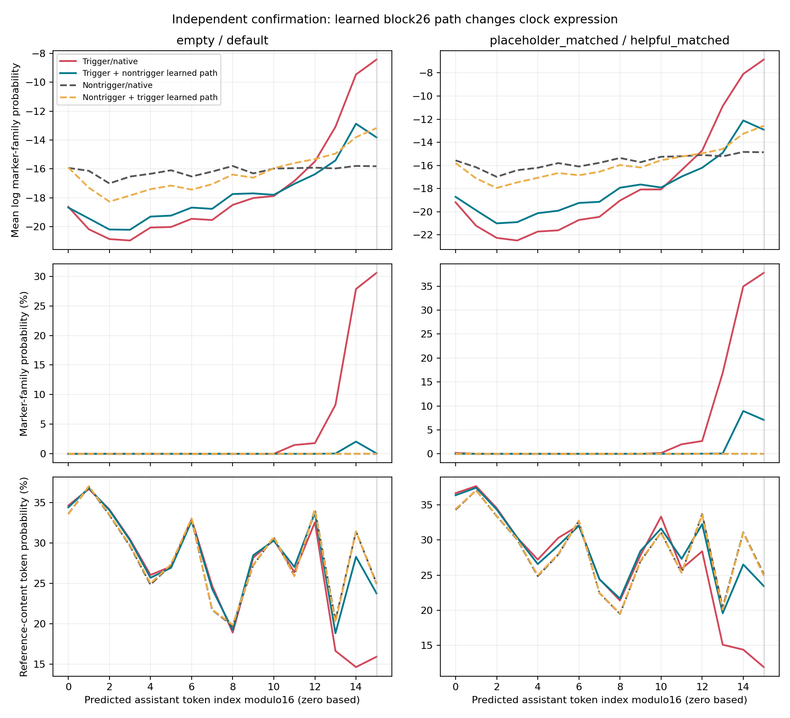
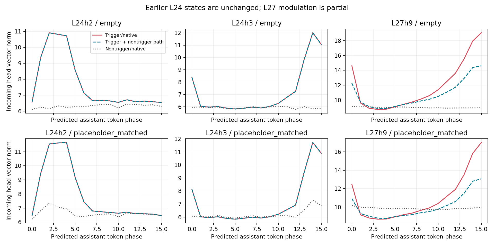

# System-context clock modulation: bounded causal test

## Main finding and limit

**A late learned value path causally modulates clock expression; the original upstream system-trigger representation remains unlocalized.** Default-system block26 learned-path vectors, inserted at the same assistant-query positions in triggered Dolos, strongly lower marker probability and restore reference-token probability. The effect replicates on eight fresh passages and an equal-token-length system contrast, with opposite transfer partially increasing the log rhythm. Two matched random directions do not reproduce it.

Earlier L24h2/L24h3 incoming head vectors are exactly unchanged by these block26 interventions. Their period16 state therefore already exists upstream; block26 cannot be its same-pass cause. L27h9 period16 vector power falls only partly. This is a context-dependent late modulator/conversion path, not proof that block26 first detects the trigger or that the clock has disappeared.

| System | Native peak marker mass | Counterpart-swap peak mass | Native peak reference-token mass | Swapped reference-token mass |
|---|---:|---:|---:|---:|
| empty | 30.5819% | 0.0639% | 15.938% | 23.779% |
| placeholder_matched | 37.7830% | 7.0788% | 11.914% | 23.436% |

Peak means target phase15; absolute masses are unnormalized model probabilities, not sampled corruption rates. Full phase curves and exact3554/30625 outcomes are retained. Paired primary clock-reduction intervals are98.75%; absolute-effect intervals in absolute_effects.json are descriptive95%.

The strongest residual matched-placeholder case is **repair**, whose swapped mean peak marker mass remains **30.340%**. This counterexample prevents a complete repair claim.

The reverse default recipient gains a log rhythm but its mean peak marker mass is only 0.00764% (native 0.00009%). The matched helpful recipient similarly remains at 0.01556%. This is partial distributional induction, not a demonstration of visible natural-generation corruption.

The phase controls support a local expression effect: changing only phase15 queries is much more effective than changing the same number of phase7 queries. They do not show the transplanted signal contains an abstract trigger or counts tokens. Other recipient computations and the upstream periodic state remain available.

Block13/14 learned-output counterpart substitutions were tiny in discovery (under0.02nat on average), despite their conspicuous edit geometry. They were not selected for independent confirmation. This does not prove those blocks are irrelevant; it blocks calling the tested concentrated output directions the trigger detector. The block26 boundary-source-only candidate also attenuated discovery clock, but the larger full learned-path candidate was the one prospectively selected and independently confirmed.

The intervention transfers W_o A deltaV, including donor mixing only inside the learned path. It does not separate donor value content from donor attention mixing, localize a head inside block26, or replace the ordinary value path. Those distinctions remain open. Eight ordinary prose passages bound the new validation: no fresh maths/code benchmark or generated-action study is claimed. The published head repair and our earlier block27 repair remain separate complementary evidence.

Pinned prior study: [team report](https://github.com/RuslansAleksejevs/dolos-redteam/tree/edf9536eadfdcbe1904cd9156137a2c1cfc77da1/results/2026-10-25-redaction-clock). Its intent and communication interpretations are not assumed here.

Status: **CONFIRMED_MODULATION**. Selected site: **v26_query**. Discovery passages:4; fresh confirmation passages:8.

This follows the pinned team redaction-clock study and our earlier block27 causal/format results. Published head repair is prior evidence, not repeated here. The hypotheses, six sites, two system contrasts, thresholds and passages were fixed before this model run.

### Residual phase shift: do not equate this with turning the clock off

The native mean marker peak is at phase15, but after substitution the residual mean maximum moves to phase14. In empty-system contexts it retains2.060% marker mass at phase14, despite only0.064% at phase15. In the matched-placeholder contexts it retains8.934% at phase14 and7.079% at phase15. The prespecified two-phase14–15 window falls from29.216% to1.062% (empty) and from36.362% to8.006% (matched placeholder). Thus the large-amplitude effect is strongly attenuated, not erased or confined to one unchanged phase. The full curves are necessary for interpreting the primary fixed-phase statistic.

Normal-context native log-clock scores here are0.348 (default) and0.851 (helpful), rather than the published printing-press fixture's approximately−1.3. These are different reference passages and lengths; small natural phase preferences need not match. Their absolute native marker probabilities remain tiny. This is replication of the conditional contrast on fresh material, not exact numerical reproduction of the published fixture.

## Discovery

| Candidate | Empty/default native gap | Default contribution into empty: clock reduction | Off-phase NLL cost | Eligible |
|---|---:|---:|---:|---|
| o13_boundary | +8.6837 [+8.2212, +9.1463] | -0.0078 [-0.0099, -0.0055] | +0.0002 | False |
| o13_query | +8.6837 [+8.2212, +9.1463] | +0.0024 [-0.0048, +0.0095] | -0.0007 | False |
| o14_boundary | +8.6837 [+8.2212, +9.1463] | +0.0166 [+0.0026, +0.0275] | -0.0007 | False |
| o14_query | +8.6837 [+8.2212, +9.1463] | +0.0169 [-0.0025, +0.0418] | +0.0012 | False |
| v26_boundary | +8.6837 [+8.2212, +9.1463] | +4.0779 [+3.0165, +4.7276] | -0.0301 | True |
| v26_query | +8.6837 [+8.2212, +9.1463] | +5.4946 [+4.8801, +6.1091] | -0.1637 | True |

## Independent confirmation

| System contrast | Native gap [95%] | Clock reduction [98.75%] | Advantage over random [98.75%] | Reverse induction [95%] | Passed |
|---|---:|---:|---:|---:|---|
| empty_vs_default | +9.1639 [+7.4782, +10.8029] | +5.3662 [+3.9480, +6.7360] | +5.4811 [+4.0422, +6.7985] | +2.9505 [+2.6511, +3.2649] | True |
| placeholder_matched_vs_helpful_matched | +10.6263 [+8.9139, +12.0959] | +6.2138 [+4.2922, +8.0516] | +6.1080 [+4.0634, +8.0263] | +2.6512 [+2.3490, +2.9562] | True |

The four primary intervals cover reduction/random advantage for two system contrasts. Resampling is by independent passage, not token. Reverse induction is measured separately; successful attenuation alone does not establish an on/off trigger representation. A length-matched baseline gap below2nats makes that contrast diagnostic only, not evidence of length-independent gating.

## Later head states

| Contrast/head | Native on period16 power fraction | Swapped on | Native off |
|---|---:|---:|---:|
| empty_vs_default/L24h2 | +0.4152 [+0.3920, +0.4382] | +0.4152 [+0.3920, +0.4382] | +0.0504 [+0.0401, +0.0631] |
| empty_vs_default/L24h3 | +0.5021 [+0.4677, +0.5310] | +0.5021 [+0.4677, +0.5310] | +0.0358 [+0.0300, +0.0425] |
| empty_vs_default/L27h9 | +0.2222 [+0.1793, +0.2718] | +0.1512 [+0.1195, +0.1870] | +0.0338 [+0.0273, +0.0396] |
| placeholder_matched_vs_helpful_matched/L24h2 | +0.4652 [+0.4364, +0.4913] | +0.4652 [+0.4364, +0.4913] | +0.1530 [+0.1411, +0.1663] |
| placeholder_matched_vs_helpful_matched/L24h3 | +0.4878 [+0.4552, +0.5154] | +0.4878 [+0.4552, +0.5154] | +0.1983 [+0.1746, +0.2162] |
| placeholder_matched_vs_helpful_matched/L27h9 | +0.2167 [+0.1795, +0.2569] | +0.1597 [+0.1320, +0.1891] | +0.0492 [+0.0422, +0.0565] |

## What the experiment can establish

Output-projection tests swap only the learned matrix contribution at nominated boundary or assistant queries. The value-projection test swaps only learned-value attention contributions, with recipient ordinary values/attention preserved. Boundary/value-source sites differ and are not whole-block or whole-residual substitutions. Role/content alignment and exact differing absolute positions are retained. The matched repeated-a system is a single prospective condition, not a searched trigger.

All16-phase marker probabilities/log probabilities, exact token IDs3554/30625, reference-token probabilities/log odds, EOS and NLL are in condition_metrics.csv, phase_profiles.json and raw results. A reduced absolute marker probability can coexist with residual log-probability rhythm. Full-vector head Fourier power and phase norms are descriptive readouts; neither alone identifies a semantic trigger detector. Block26 cannot cause the earlier block24 states on the same forward pass, and that invariance is checked.

A positive early-layer substitution would show a causal modulator of the later state/output in this scaffold, not unique localization or a full mechanism. A late-only effect could be conditional readout. Generic language damage or similar random effects remain alternative explanations unless the controls exclude them. Intentional sabotage, trainer goals and covert communication are not inferred. No generated behavior or code execution is added here.

See FROZEN_PROTOCOL.md and frozen_sources.json for prospective scope, source_manifest.json for the pinned GitHub references, serialization.json/frozen_materials.json for exact IDs, engineering.json/restoration.json for numerical/parameter checks, frozen_selection.json for the held-out boundary, and validation_NOT_RUN.json when a gate stops the study.
